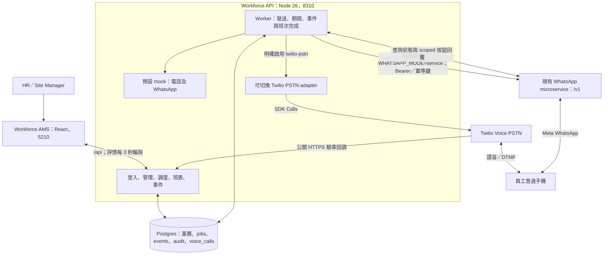

# Workforce 獨立項目架構

2026-11-03 更新。Workforce 自行管理登入、角色、Site、員工、調度、班表與資料庫。Core API／AMS 不在執行鏈路。需求方已澄清沒有另一個 Messaging Service，並選擇在 Workforce 獨立實作 Twilio PSTN，沿用 Core SDK 做法。

## 執行結構

圖中的 PSTN 路徑已實作、僅以 fake client 驗證，尚未真機試撥。預設仍是 mock，WhatsApp 預設 mock，可獨立切換為 microservice adapter。Worker 與 API 共用程序；持久隊列在 Postgres，沒有額外 queue server。

## 責任與資料

| 元件 | 責任 |
|---|---|
| AMS | 獨立登入、管理表單、候選清單、週班表、輪詢、真實／模擬模式提示 |
| API | Session、Site 權限、資格、名額與重疊交易、Audit、統一回覆處理 |
| Worker | send-attempt、request-deadline、process-event、有限重試、班次完成、取消追蹤 |
| PSTN adapter | 號碼與設定、Calls、TwiML、驗章、DTMF、狀態映射、持久提交與取消 |
| Twilio | 普通電話外撥、播放語音、收集 DTMF、提供回調 |
| WhatsApp adapter | 呼叫既有 microservice、模板參數、持久快照與 key、查詢狀態和按鈕回覆 |
| WhatsApp microservice | Meta API、入隊與送達記錄、收訊、模板；本項目只呼叫既有接口 |

users、sessions、site_managers 管理身份；staff、sites、site_staff 管理人員與地點；requests、candidates、assignments、shifts 管理調度與班表；attempts、jobs、message_deliveries、message_events 管理發送及回覆；voice_calls 保存每次 PSTN 提交、Call SID、語音快照、狀態和取消意圖；whatsapp_submissions 保存固定請求 key、模板快照及 message UUID／Meta ID；audit_log 保存業務變更。

API 和 Worker 共用 Attempt ID 作 correlation_id。外部網路在資料庫交易以外執行。Call SID 尚未取得且提交結果不明時，不自動重撥；驗章回調可恢復綁定。回覆統一走既有名額與班次交易，遲到狀態不覆寫最終回覆。

本機 workforce_local 與 workforce_test 位於 127.0.0.1:5432，各自獨立。沒有 Core 身份、資料庫或 Site 映射。

## 規格與更正

九份原始 specs 保持原文。06／07 的 Messaging Service 名稱依需求方最新澄清解讀為既有渠道能力，PSTN 直接在 Workforce 實作。07 的提案仍可供未來 WhatsApp 邊界轉換參考，不是外部服務存在的前提。`spec-addendum.md` 記錄需求方確認；`pstn-implementation-plan.md` 記錄本批進度。

2026-11-03 WhatsApp 補充：需求方提供 Live4Well 交接，確認現有 WhatsApp 專用 microservice。Workforce 沿用 gym-aesthetics-api-admin 的 server-to-server 契約，不需要該系統 runtime 或 React package。微服務目前只轉發 inbound，而且單一 webhook；本版使用驗證 API key 的查詢，保留其他 consumer 設定。詳見 whatsapp-integration.md。

## AMS 管理設定與音檔

channel-settings 保存 AES-GCM 加密的 immutable 設定版本與 active 指標，channel-runtime 依 Attempt 版本路由 Worker／歷史回調；API status 同時提供設定 revision。新設定不改既有工作來源，原 mock 工作保持 mock。管理 API 只給 admin，Audit／API 回應遮罩密鑰。

voice_assets 保存三語音檔與不可猜播放 token，request_voice_bindings 限同 Site 草稿，Call 保存實際播放 URL 快照。Twilio 使用 Play/Gather，無 Say。設定管理、模板管理、通用提示與調度完整錄音均有 AMS 入口；不接入外部 TTS，使用上傳的完整錄音。工種不新增。
